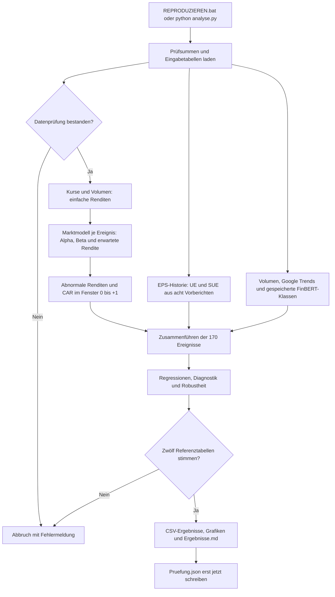
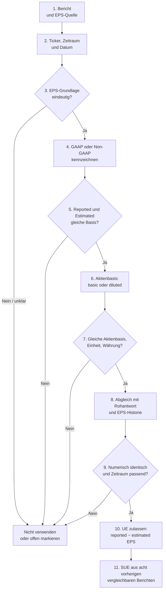

# Event Study – verständliche Kernversion

**Grafiken ansehen:** `Interface/index.html` öffnen. Dort stehen alle 25
Abbildungen des Word-Arbeitsstands und die neu berechneten Diagramme bereit.
Die kurze Anleitung dazu liegt in `Interface/README.md`.

**Start: `REPRODUZIEREN.bat` doppelklicken.** Die Ergebnisse werden neu berechnet
und mit der geprüften Auswertung vom 28.10.2026 verglichen.
Auf einem anderen Computer zuerst Python 3.12 (64 Bit) installieren und
`INSTALLIEREN.bat` ausführen. Danach läuft die Analyse ohne Internet.

## Die drei Schritte im Code

| Datei | Aufgabe |
|---|---|
| `analyse.py` | Eingaben prüfen, CAR und die fünf Einflussgrößen berechnen, Auswertung starten und Ergebnisse prüfen. `main()` verbindet die Schritte. |
| `statistik.py` | Regressionen, feste Effekte, Standardfehler, Diagnostik und Robustheitsprüfungen. |
| `grafiken.py` | Die Abbildungen aus den berechneten Ergebnissen erstellen. |

`Daten/` enthält die sechs benötigten Eingabetabellen.
`Ergebnisse/Ergebnisse.md` zeigt die wichtigsten Zahlen; daneben liegen die
vollständigen Ergebnistabellen und unter `Abbildungen/` die PNG- und PDF-Dateien.
Ein erneuter Lauf ersetzt diese erzeugten Ergebnisse.

## Programmablauf

Der folgende Ablauf zeigt, wie aus den eingefrorenen Eingaben die Ergebnisse
entstehen. Jeder Fehler in einer Eingabe- oder Reproduzierbarkeitsprüfung
beendet den Lauf, bevor neue Ergebnisdateien als erfolgreich gekennzeichnet
werden.

## Datenprüfung

Die Prüfung arbeitet in zwei Ebenen:

1. **Automatische Prüfung beim reproduzierbaren Lauf:** `analyse.py` prüft
   zunächst die SHA-256-Prüfsummen aller sechs CSV-Dateien aus
   `Daten/Herkunft.json`. Danach werden die Struktur und die erwartete Abdeckung
   geprüft: genau 170 eindeutige Ereignisse, Veröffentlichungen nach
   Börsenschluss (`AMC`) und 113 Ereignishandelstage. Bei den Satzbewertungen
   werden doppelte Satz-IDs und unbekannte FinBERT-Klassen abgewiesen. Die
   Berechnung darf erst weiterlaufen, wenn alle benötigten Zeitfenster und
   numerischen Werte vollständig sind. Zum Schluss werden zwölf erzeugte
   Ergebnistabellen mit der Referenzauswertung verglichen; erst bei
   Übereinstimmung entsteht `Ergebnisse/Pruefung.json`.
2. **Fachliche Quellenprüfung vor dem Einfrieren der Eingaben:** Die Zahlen
   werden nicht nur auf ihr Format, sondern auf ihre inhaltliche
   Vergleichbarkeit geprüft. Die nachstehende Übersicht beschreibt speziell
   die EPS-Prüfung. Sie ist eine Quellen- und Zuordnungsprüfung; die
   Reproduzierbarkeitsversion kann die ursprünglichen Anbieterbelege nicht
   erneut herunterladen.

### GAAP-/Non-GAAP-Prüfung

Für jedes EPS-Wertepaar wird zuerst festgestellt, ob beide Werte auf
**GAAP** (US-Rechnungslegungsstandard) oder beide auf einer ausdrücklich
bezeichneten **Non-GAAP-/bereinigten** Grundlage beruhen. GAAP und bereinigtes
EPS dürfen nicht miteinander verrechnet werden: Dann wäre die
Gewinnüberraschung durch unterschiedliche Definitionen und nicht durch eine
Nachrichtenreaktion bestimmt. Die Kennzeichnung wird aus der Anbieterquelle,
dem Earnings-Release beziehungsweise der Überleitung „non-GAAP to GAAP“
übernommen. Fehlt diese Information oder bleibt die Grundlage widersprüchlich,
wird das Wertepaar nicht stillschweigend harmonisiert, sondern als fachlich
offen ausgeschlossen.

Anschließend werden tatsächliches und erwartetes EPS für dieselbe
Berichtsperiode, denselben Ticker und dieselbe Einheit abgeglichen. In der
vorgelagerten Datenprüfung werden die Werte mit den Anbieterantworten
verglichen; der reproduzierbare Lauf prüft danach die Prüfsummen der
eingefrorenen CSV-Dateien, die Übereinstimmung von Ereignistabelle und
EPS-Historie sowie die 170 Ereignisse. Er kann jedoch aus den reduzierten
CSV-Spalten nicht nachträglich beweisen, ob jedes historische Wertepaar
ursprünglich GAAP oder Non-GAAP war. Diese fachliche Einschränkung bleibt
deshalb als Quellenfrage dokumentiert.

### Prüfung der Aktienbasis

Zusätzlich wird geprüft, ob beide EPS-Werte dieselbe Aktienbasis verwenden:
**basic EPS** (unverwässert) und **diluted EPS** (verwässert) sind nicht
austauschbar. Die Basis muss für reported und estimated EPS gleich sein; ebenso
müssen Einheit, Währung und die Behandlung von Aktiensplits stimmen. Bei
Splitereignissen werden historische EPS-Werte nur dann verglichen, wenn die
Anbieterwerte auf derselben (gegebenenfalls nachträglich angepassten)
Splitbasis vorliegen. Bekannte Splits von Apple (31.08.2020, 4:1), Amazon
(06.06.2022, 20:1) und Alphabet (18.07.2022, 20:1) werden dabei als
Plausibilitätskontrolle berücksichtigt.

Erst wenn Perioden-, GAAP-/Non-GAAP- und Aktienbasisprüfung bestanden sind,
wird die Überraschung
`UE = reported EPS − estimated EPS` gebildet. Für SUE werden anschließend
genau die acht vorherigen Berichte **derselben vergleichbaren Grundlage**
verwendet. Eine bloße numerische Übereinstimmung mit einer API-Antwort ersetzt
diese fachliche Prüfung nicht; die aktive Kernversion weist diese Grenze
transparent aus, anstatt eine nicht vorhandene Quellenbestätigung zu
behaupten.

## Was genau berechnet wird

1. **Einfache Rendite:** `r_t = P_t / P_(t−1) − 1`, für Aktien und SPY.
2. **Marktmodell:** Für jeden Bericht werden Alpha und Beta über die Handelstage
   `[-250,−30]` geschätzt. Erwartete Rendite = `Alpha + Beta × SPY-Rendite`.
3. **CAR:** Tatsächliche minus erwartete Rendite ergibt AR.
   `CAR = AR_0 + AR_1`, ohne Aufzinsung. Tag 0 ist der erste Handelstag nach der
   Veröffentlichung nach Börsenschluss. `|CAR|` misst die Stärke der Reaktion.
4. **Einflussgrößen:** SUE, VOL, PREVOL, SEARCH und TONE; Definitionen unten.
5. **Regressionen:** CAR mit SUE; |CAR| mit |SUE|. Beide enthalten VOL, PREVOL,
   SEARCH, TONE sowie Unternehmens-, Berichtsjahres- und Kalenderquartalseffekte.
   Standardfehler werden nach Ereignishandelstag geclustert (CR1, t-Tests mit
   G−1 Freiheitsgraden). Die Hauptmodelle verwenden keine Winsorisierung.
6. **Prüfungen:** Einzelmodelle, Korrelationen, VIF, Residuen, Breusch-Pagan,
   Jarque-Bera, Cook-Distanzen, AAR-/CAAR-Tests; außerdem Modelle ohne feste
   Effekte, mit Winsorisierung, ohne jeweils ein Unternehmen sowie mit
   CAR-Fenstern `[-1,+1]` und `[0,+2]`. Beim Fensterwechsel bleiben die
   Einflussgrößen unverändert.

| Variable | Definition |
|---|---|
| SUE | Tatsächlicher minus erwarteter Gewinn je Aktie, geteilt durch die Stichprobenstandardabweichung der Gewinnüberraschungen der acht vorherigen Berichte. |
| VOL | Mittleres standardisiertes logarithmiertes Handelsvolumen an Tag 0 und +1; Vergleichszeitraum `[-60,−10]`. |
| PREVOL | Dieselbe Standardisierung, gemittelt über `[-3,−1]`. |
| SEARCH | Logarithmus des Suchinteresses in der Ereigniswoche geteilt durch den Median der acht vorherigen Wochen; alle neun Werte aus demselben Export. |
| TONE | `(positive Sätze − negative Sätze) / alle Sätze`, einschließlich neutraler Sätze. |

In den CSV-Dateien stehen Renditen als Dezimalzahlen: **0,01 entspricht einem
Prozentpunkt**. Die Diagramme der Renditen verwenden Prozentpunkte.
Die Logarithmen von Handelsvolumen und Suchinteresse gehören weiterhin zu deren
Definition; die Kursrenditen sind einfach.

## Reproduzierbarkeit

Die Kernversion reproduziert die **statistische Auswertung ab den bereinigten
Eingabetabellen**. Sie lädt keine Daten herunter, bereinigt keine ursprünglichen
Anbieterdateien und führt FinBERT nicht erneut aus. TONE wird aus den 80.262
gespeicherten Satzbewertungen neu aggregiert. Alle weiteren Kennzahlen und
Modelle werden neu berechnet.

Jeder Lauf prüft die Eingabedateien anhand ihrer Prüfsummen und vergleicht
zwölf Ergebnistabellen mit dem bisherigen CAR-Lauf. Erwartet werden **170
Ereignisse und 113 Datumscluster**. Die numerische Toleranz beträgt relativ
`1e-9`, absolut `1e-11`. Nur die Herkunftsbezeichnung von TONE wurde präzisiert;
sie behauptet nun keine neue FinBERT-Inferenz. `Ergebnisse/Pruefung.json` wird
erst nach erfolgreichem Abschluss geschrieben.

Die vollständige bisherige Fassung mit Rohdaten, Transkripten, Aufbereitung,
Quellennachweisen und historischen Ergebnissen liegt im benachbarten Ordner
**`Event Study - Sicherung vor Vereinfachung 2026-10-29`**. Die lokale
Python-Umgebung `.venv` bleibt bei dieser Kernversion und ist kein Quelldatensatz.

Entfernt aus der aktiven Fassung sind die Browseroberfläche, Downloads,
Audioverwaltung, zusätzliche Sentimentverfahren, alte Log-Rendite-Varianten,
mehrfache Datenbestände, historische Berichte und Spezialexporte nach Jamovi,
PSPP und SQLite. Für die Interpretation gelten die Einschränkungen der
Seminararbeit: Die Regressionen zeigen Zusammenhänge und beweisen keine Kausalität.
