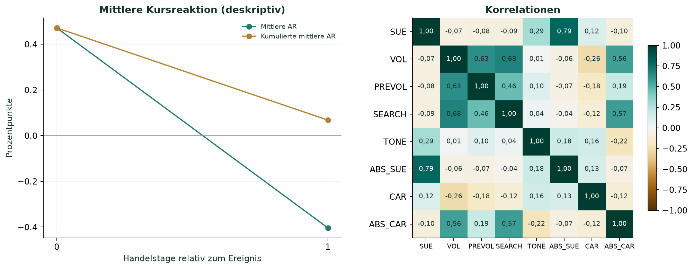

# Event Study mit kumulierten abnormalen Renditen

Reproduzierbare Auswertung zur W-Seminararbeit von Johann Pongratz:
**170 Quartalsberichte von Apple, Amazon, Alphabet, Meta und Microsoft**,
2018 bis April 2026. Benchmark: SPY. Es werden einfache Tagesrenditen verwendet.

Diese schlanke Fassung besteht aus drei Python-Dateien. Die
[interaktive Version](https://github.com/JohannPongra/event-study-car-interaktiv)
kann zusätzlich neue Daten sammeln und Analysen über eine lokale Oberfläche starten.

## Start unter Windows

1. Repository herunterladen oder klonen; Python **3.12, 64 Bit** installieren.
2. `INSTALLIEREN.bat` ausführen.
3. `REPRODUZIEREN.bat` ausführen.
4. `Interface/index.html` öffnen, um die Grafiken anzusehen.

Nach der Installation läuft die Reproduktion offline. Die vollständigen Tabellen
liegen unter `Ergebnisse/`; `Ergebnisse/Ergebnisse.md` fasst die Hauptmodelle zusammen.

## Was neu berechnet wird

- Einfache Renditen `r_t = P_t / P_(t−1) − 1` für Aktien und SPY.
- Marktmodell über die Handelstage `[-250,−30]`; `CAR = AR_0 + AR_1`.
- SUE, VOL, PREVOL, SEARCH und TONE; Modelle für CAR und |CAR|.
- Unternehmens-, Jahres- und Quartalseffekte; nach Ereignishandelstag geclusterte Standardfehler.
- Diagnostik, Ereignistests, Einzelmodelle und Robustheitsprüfungen.

Jeder Lauf vergleicht **zwölf Ergebnistabellen** mit der geprüften Referenz:
**170 Ereignisse, 113 Datumscluster**. Das Ergebnis steht in `Ergebnisse/Pruefung.json`.
Die Regressionen beschreiben Zusammenhänge; sie belegen keine Kausalität.

## Dateien und Daten

| Datei | Aufgabe |
|---|---|
| `analyse.py` | Eingaben, Kennzahlen, Ablauf und Referenzvergleich |
| `statistik.py` | Regressionen, Diagnostik und Robustheit |
| `grafiken.py` | Diagramme als PNG und PDF |
| `Interface/` | Lokale Galerie mit 25 Abbildungen des Arbeitsstands und zehn berechneten Diagrammdateien |

Die Reproduktion beginnt bei bereinigten Eingabedaten. Enthalten sind **170 vollständige Transkripte** sowie **80.262 bewertete Sätze
mit Text und Wahrscheinlichkeiten**. TONE wird daraus neu
aggregiert; eine neue FinBERT-Inferenz findet in dieser Fassung nicht statt.
[Alle Transkripte einzeln lesen](Daten/Transkripte/README.md). Die Eingabetabellen
wurden unverändert übernommen.

[Ausführliche Anleitung](ANLEITUNG.md) · [Datenherkunft](Daten/README.md) ·
[Grafiken erstellen und aktualisieren](Interface/README.md)
